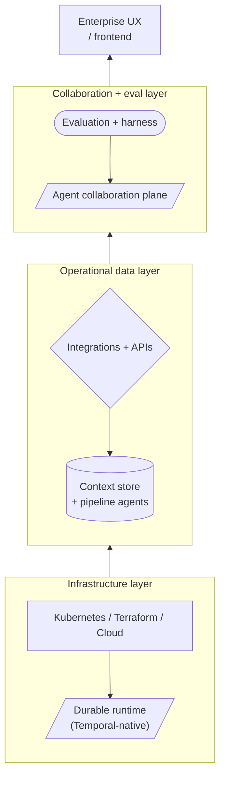
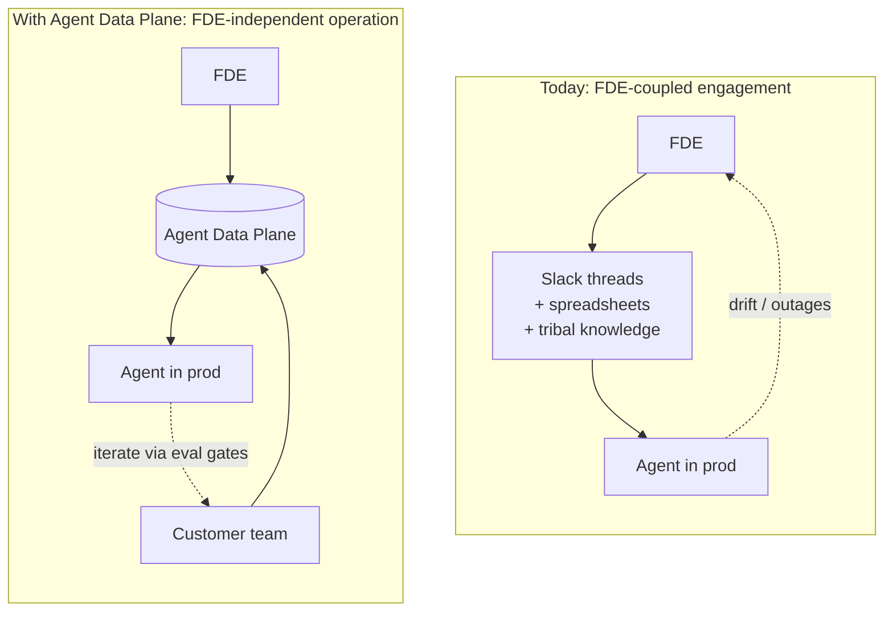
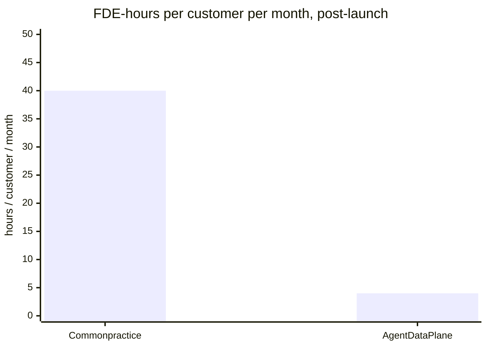

Motivation: I share why Forward Deployed Engineers matter more than ever and the two problems I keep watching them solve on every engagement. Architecture and benchmarks come later in the post.

---

## Why I care about forward deployed engineering

I spent years deploying open-source applications onto customer infrastructure. The world has shifted since then. Coding models enable us to ship bespoke software faster than at any point in my career.

Despite all that velocity, every AI-native company I talk to keeps **_hiring Forward Deployed Engineers as fast as recruiters can find them_**. That alone should tell us something.

I've spent enough time wearing the FDE hat myself to keep seeing the same two problems on every engagement. They both pull in the same direction, and I think they explain why headcount keeps going up even as code generation gets cheaper.

### Problem 1: evaluation alignment and handover

Most agent deployments end up automating the work of an industry expert. What the agent does (triage a support ticket, qualify an insurance case, screen a legal document) lives inside what I keep calling operational expertise.

An engineer can judge code quality and harden the reliability of a workflow. The engineer can't judge whether the agent's answer counts as clinically correct on a healthcare ticket or legally defensible on a contract. The industry expert can. So the FDE sits next to that expert and the two of them iterate together. That collaboration produces most of the actual product.

The hard part comes at handover. The industry expert needs visibility into what the agent does and the ability to change prompts and evals over time, without learning git, CI/CD, or Python.

The iteration loops that lift an agent past 99% accuracy on the long tail remain too cumbersome for a non-engineer to drive. In practice, plenty of prototypes that work in a demo never reach production because nobody trusts the agent enough to ship it for real, and nobody on the customer side feels able to keep improving it after launch.

It all comes down to giving agents the right context and translating operational expertise into a prompt the industry expert can keep refining.

### Problem 2: the data foundation

The second problem hides behind the first. Connecting an agent to the right context inside an enterprise means building integrations and deploying them inside infrastructure the FDE doesn't own. Salesforce, EMRs, internal APIs, file shares, vector stores, message queues, audit logs.

An FDE rarely has enough DevOps support to deploy securely into a customer's cloud or to pull the relevant data out without tripping every security review. The problem looks unglamorous from the outside, but it eats a disproportionate share of the engagement.

Together, the FDE carries a dual responsibility.

Half the job: establish the data foundation that lets an agent reach into the customer's systems safely.

The other half: help the industry expert translate operational expertise into an agent harness they can trust and keep training over time. Neither half lives in the model.

Both halves explain why FDEs keep getting hired faster than coding agents reduce demand for them. Whatever the business card claims, the role amounts to **operational data engineering for autonomous systems**.

---

## The data gap

A recent [Fivetran and Redpoint survey of 400 enterprise data leaders](https://cdn.prod.website-files.com/6130fa1501794e37c21867cf/69f4e66c74c5b3fa05ce0fad_Agentic%20AI%20Report_V5.pdf) put numbers on what most practitioners feel in their bones: roughly 60% of enterprises sink millions to tens of millions into agentic AI, while only about 15% feel ready to support it in production.

The gap looks enormous, and the report reads unusually blunt about the cause. The bottleneck has nothing to do with model quality. It has everything to do with the data foundation underneath the agents.

Yes, a data-tooling vendor calling data the bottleneck counts as zero shocking news. Fair point. But the same pattern shows up everywhere I've worked. The project of the week could turn into Kubernetes-native infrastructure one quarter and Temporal workflows the next. Sooner or later you also need durable agents on top of a context store. Neither the LLM nor the prompt nor the orchestration layer ever turned out to count as the hardest part. The hardest parts came down to reliable context and fresh operational data plus the lineage, governance, interoperability, evaluation, and handover that lets a customer trust either of them. In short, operational data infrastructure.

The model has turned into a commodity. The plumbing around it hasn't.

---

## The wrong mental model

The industry likes to describe FDEs as AI consultants, integration engineers, or "customer engineers." That framing misses the point and probably underprices the role.

In every serious deployment I've watched, the FDE ends up doing something closer to **operational alignment engineering**. They map workflows and operational semantics to the actual systems they touch. Then they wire up the pipelines and stand up the context store. Then they sit with domain experts long enough to translate vague KPIs into evaluation suites that survive the next prompt change. After that, they iterate on production behaviour week after week until trust shows up.

The hard question stopped sounding like "how do we build an agent." Claude Code answers large parts of that already. The hard question turned into "how do we build a trustworthy operational context system for an agent." Different problem, different muscle.

---

## A real engagement

`Consider a healthcare rehabilitation company. They want one agent that helps coordinators with patient intake along with insurance eligibility, treatment qualification, reimbursement, and scheduling.`

The initial ask sounds disarmingly simple:

> Build an AI agent to help our coordinators.

The FDE accepts the engagement, and then reality shows up.

A lot of things show up at once. Insurance qualification rules nobody wrote down. Escalation conditions that depend on the time of day. Reimbursement constraints that vary by region, audit requirements buried in a compliance binder, and acceptable confidence thresholds that the operations lead "knows when she sees them." None of which live in any single place a human or model can read. Then come the systems: Salesforce, two EMRs, a pile of PDFs, an email firehose, internal APIs, Slack, billing. And finally the questions nobody asked at the kickoff:

- What defines a successful qualification?
- When should the agent escalate?
- What level of hallucination passes muster?
- Which data source wins when two disagree?
- How do we measure production performance after week one?

None of those answers live in the model. None live in Kubernetes, APIs, or the orchestration layer. They live inside the operational expertise of the customer. The deployment only succeeds if the FDE's systems knowledge and the customer's operational knowledge stay continuously aligned. That alignment becomes the real product. The agent comes out as a side effect.

---

## How this works today

Most enterprise AI deployments coordinate that alignment through Slack threads, spreadsheets, weekly meetings, screenshots, Jupyter notebooks, dashboards, prompt experimentation, and tribal knowledge. It works, in the way duct tape works.

The consequences play out predictably. Timelines stretch and handovers fall apart. Prompts drift while retrieval silently degrades, and workflows turn opaque to everyone who missed the original Slack channel. Then the FDE goes on vacation, and for two weeks the agent stops escalating correctly while nobody can say why.

The deeper consequence runs further: the enterprise stays operationally dependent on the original FDE forever. Which works great if you sell FDE hours and works badly if you want a business that grows faster than headcount.

---

## What scaling FDE teams costs

This pain turns acute around the 10 FDE mark and existential around 50 to 100. At that scale, every AI company I've looked at quietly rebuilds the same internal platform, badly, in parallel. Integration tooling and eval systems get reinvented per engagement. Prompt tooling, deployment systems, observability loops, review dashboards, and context pipelines all show up twice, sometimes three times, with slightly different bugs each time.

I started caring about the problem at exactly that moment. Every company scaling FDEs accidentally builds the same product. They don't call it a product, though, and it doesn't ship to anyone outside the team.

---

## The data foundation problem

The same survey gives a useful breakdown of what enterprises consider the top barriers to AI adoption:

| Barrier                               | Share of respondents |
| ------------------------------------- | -------------------- |
| Data quality and lineage              | 42%                  |
| Sovereignty and regulatory compliance | 39%                  |
| Security and privacy risk             | 39%                  |

Notice what falls off that list. Model intelligence doesn't appear. Neither does prompt quality, nor the choice of orchestration tool. The real bottleneck comes down to operational data reliability. The report keeps coming back to four properties that enterprise AI needs to earn trust:

| Property                   | Why it matters                         |
| -------------------------- | -------------------------------------- |
| Freshness and reliability  | prevents stale decisions in production |
| Transparency and lineage   | makes audits and rollbacks possible    |
| Interoperability           | avoids fragmented, incompatible agents |
| Governance and sovereignty | satisfies the people who can say "no"  |

That list also describes accurately what every FDE I know does on the side, somewhere among the integrations.

---

## The agent data plane

Enterprise AI needs an **Agent Data Plane**.

I don't mean another orchestration tool or AI IDE or hosted copilot that the security team rejects in week three. I mean a deployable operational data foundation for autonomous systems. Concretely: it keeps enterprise context continuously in sync and fresh enough to trust. It manages lineage so audits stop feeling like a fire drill. And it gives FDEs and domain experts one shared surface where governance, evaluation, and handover all happen in the same place.

The architecture I keep sketching on whiteboards groups into four layers:

Every layer exists for one reason. Making reliable enterprise context usable by autonomous systems in production. That throughline holds across every layer. If a layer doesn't help with that, it counts as a feature, not infrastructure.

Most of the operational data layer deserves its own treatment. I've written about the context store piece separately in [my earlier writeup on the context plane](), which dives into the entity-first primitive and the cold/warm cache economics, plus early benchmarks I've collected on a Rust serverless prototype.

The shape of an engagement changes when this stack sits underneath:

The FDE still shows up in both pictures. In the second one, the customer team also has a seat at the table. The FDE eventually walks away.

---

## What I keep ending up building

Over the last few years, working on production agent systems, I keep ending up with the same primitives in roughly the same order. Not by design, by attrition.

**Infrastructure plane.** Kubernetes-native deployments, Terraform workflows, GitHub-driven CI/CD, multi-cloud provisioning, cluster automation. The goal looks unglamorous: deploy reliably into customer infrastructure without writing a bespoke runbook every time.

**Durable runtime.** Temporal-native execution, durable agents, retries, streaming, long-running workflows, Go/Python/TypeScript SDKs. Production agents need to survive process restarts and partial failures. "Call the LLM in a loop" works fine until it doesn't, and the moment it doesn't almost always hits in the small hours of the night.

**Pipeline and context systems.** Pipeline agents, context stores, retrieval patterns, operational memory, orchestration patterns. The whole point: keep enterprise context fresh, queryable, and reproducible, instead of stitched together inside a prompt at request time. The deeper architecture for the context store sits in [Context Plane: A Point of View](). That post covers the entity-first namespace and the S3-compatible object storage approach, plus how Rust serverless query nodes hit single-digit ms warm-path latency at 10k docs.

**Collaboration layer.** This one surprised me. It turned out to carry the highest payoff of all the pieces. Not deployment, not prompts, not orchestration. Trust gets built when FDEs and enterprise experts iterate together inside one tool, and KPIs eventually start to align in the same place. That collaboration (the part I care about most) also lets the enterprise become operationally independent after handover. Without that, the FDE never gets to leave.

---

## Current stack vs agent data plane

Most prototype stacks today look something like the left column. They work for a demo. They struggle by the 6-month operational review:

| Layer          | Common practice today              | Agent Data Plane                  | Why it matters                                  |
| -------------- | ---------------------------------- | --------------------------------- | ----------------------------------------------- |
| Frontend       | custom dashboards per project      | shared collaboration UX           | one surface for FDE + domain expert             |
| Agents         | Python loops + agent SDKs          | durable runtime + SDKs            | survives restarts and partial failures          |
| Evals          | notebooks and spreadsheets         | structured eval loops in CI       | catches regressions before customers do         |
| Context        | vector DB + scripts                | managed context store + pipelines | freshness becomes the platform's job, not yours |
| Integrations   | bespoke APIs per customer          | reusable integration agents       | same connector ships across engagements         |
| Runtime        | containers + ad-hoc retries        | durable workflows, replayable     | re-running a failed step doesn't lose state     |
| Infrastructure | Kubernetes/Terraform, hand-written | Kubernetes-native, declarative    | the same deployment recipe everywhere           |

And the same comparison reframed by problem:

| Problem                | Common approach          | Agent Data Plane        | Note                                                                                         |
| ---------------------- | ------------------------ | ----------------------- | -------------------------------------------------------------------------------------------- |
| Data freshness         | batch syncs              | continuous pipelines    | feeds the [context plane]() on a schedule you control |
| Context reliability    | ad-hoc RAG               | managed context systems | entity-first, deterministic materialization                                                  |
| Governance             | custom per-project logic | enforceable policies    | one policy engine, every agent                                                               |
| KPI alignment          | meetings + spreadsheets  | structured eval loops   | versioned suites, not Slack consensus                                                        |
| Prompt iteration       | manual experimentation   | collaborative tooling   | domain expert edits, FDE reviews, eval gates merge                                           |
| Workflow observability | fragmented dashboards    | unified traces          | one trace per workflow, end-to-end                                                           |
| Handover               | tribal knowledge         | operational continuity  | customer keeps shipping after the FDE leaves                                                 |
| FDE scaling            | linear headcount         | reusable infrastructure | same platform across N engagements                                                           |

The right column takes more work to build. It also escapes the rebuild on every engagement.

---

## Numbers I keep seeing

I haven't published a controlled study yet. The figures below come from FDE engagements I've watched at roughly a dozen AI-native companies, plus internal pilots of the stack I sketched above. Treat them as the rough-order argument, not a marketing claim.

| Metric                                             | Common practice today | Agent Data Plane | Note                                                                          | Improvement    |
| -------------------------------------------------- | --------------------- | ---------------- | ----------------------------------------------------------------------------- | -------------- |
| **Time to first agent in production**              | 8 to 12 weeks         | 1 to 3 weeks     | signed engagement until real production traffic                               | ~4-8× faster   |
| **FDE-hours per customer per month (post-launch)** | 30 to 50              | 2 to 5           | review and escalation once handover lands                                     | ~6-15× fewer   |
| **Customer prompt iteration (no FDE in the loop)** | days (ticket to FDE)  | minutes          | self-serve in the collaboration plane, gated through eval suites              | ~100× faster   |
| **Eval suite turnaround**                          | hours to days         | minutes          | run-to-result for a versioned eval, running in CI on every prompt change      | ~10-50× faster |
| **Customers a single FDE can support**             | 1 to 3                | 8 to 12          | sustainable load when the platform handles infra and handover                 | ~4-6× more     |
| **Engagement still healthy at month 9**            | ~30 to 40%            | ~80 to 90%       | observational. The usual failure mode looks like "FDE left, retrieval rotted" | ~2-3× higher   |

The single number I find most striking sits in the post-launch row. Most FDE engagements never end. The customer keeps paying for the FDE's calendar long after the agent ships. Two mechanisms drive most of the savings. First, the customer's domain expert edits prompts directly, gated through the eval suite, so the FDE no longer acts as the only person allowed to change anything. Second, the context store keeps freshening itself, so nobody manually re-runs the ingest after a Salesforce schema change.

The "Common practice today" column swings wildly across engagements, and a skeptic would point that out. The 8 to 12 week and 30 to 50 hour figures cover a wide range. The floor rarely lands below 4 weeks or 15 hours. The "Agent Data Plane" column draws on internal pilots and a handful of customers running this stack in production. Once the operational data foundation sits in place, the numbers stop looking heroic.

---

## Interoperability stops counting as optional

The same survey found that 86% of organizations consider interoperability important or critical for AI systems. That number lines up with every procurement conversation I've ever sat through.

Whatever the winning platform looks like, it can't lock customers into a hosted SaaS they don't control. It can't replace the enterprise infrastructure they already paid for. And it can't ship a proprietary deployment model that the customer's security team would veto. It has to slot into Kubernetes, Terraform, existing cloud accounts, existing CI/CD, and the customer's security model without asking permission.

So I keep ending up at the same architectural bet: deployable, Kubernetes-native, operational data infrastructure. Anything that doesn't deploy into the customer's environment gets caught at the procurement door.

---

## The handover problem

The handover stands out as the most underrated failure mode in enterprise AI. Most engagements that look successful at month three quietly fail at month nine because:

- the operational knowledge stayed in the FDE's head,
- nobody else understands the prompts,
- retrieval degraded and nobody noticed,
- workflows drifted as the business changed,
- and the evaluation loops disappeared after launch.

The customer ends up permanently dependent on the original FDE, which feels great for billable hours and terrible for everyone's sanity, including the FDE's. A real Agent Data Plane changes that shape. The enterprise team keeps iterating on prompts and inspecting analytics on their own. They evolve KPIs against the same eval suite the FDE used. Production workflows keep running without permission from a vendor. The FDE can move on. The engagement succeeded at that moment, not at the moment the agent first shipped.

---

## Where coding goes next

I increasingly think coding shifts away from humans writing applications and toward humans designing operational systems that keep improving themselves.

Coding agents already write more of the code each quarter. APIs, integrations, infrastructure, workflows, orchestration. The human bottleneck moves upward, into evaluation, operational semantics, trust, governance, workflow correctness, and business alignment. That shift doesn't count as a downgrade. That work counts as the interesting part.

Forward Deployed Engineers, in that world, become operational architects for autonomous systems. The companies that win enterprise AI probably don't come from the camp with the best models or prompts or orchestration. They come from the camp that gets enterprise context into production fastest while keeping the data foundation reliable as everyone else's drifts. They also come from the camp that hands over systems cleanly enough that the customer keeps improving production workflows long after launch, with no permanent vendor seat required.

The companies that build the Agent Data Plane, in short, even if they end up calling it something else.

---

## So what?

If you find yourself an FDE drowning in Slack threads, spreadsheets, and screenshots while pretending the pile of them counts as a deployment process, you don't stand alone, and you probably build the same platform every other FDE keeps building. If you scale an FDE team past 50 people and you've started to notice the same dashboard get rewritten three times, take that as the signal.

I spend most of my time on this problem now. If any of this resonates, or if you build (or buy) something in the shape of an Agent Data Plane, I would love to hear how you think about it.
