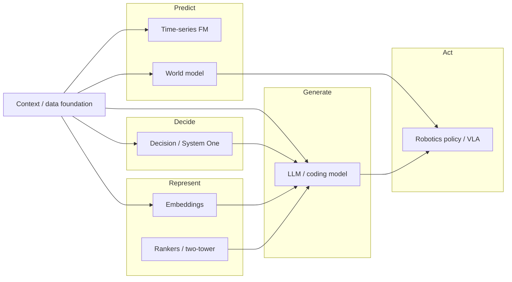

Motivation: I firmly believe Super Intelligence comes from composing different models across levels of intelligence and frequencies, not from one generative monolith. New foundation models that let agents learn from experience excite me most.

---

## Jev as a decoupling signal

For a few years the default mental model looked simple: bigger generative language models would absorb every other job. Classification? Prompt an LLM. Routing? Prompt an LLM. Scoring a ticket? Prompt an LLM. Forecasting? Ask ChatGPT. Ranking? Ask ChatGPT. The same string-in, string-out interface kept winning demos, so it kept winning mindshare.

Then TypeSafe shipped [Jev](https://typesafe.ai/blog/introducing-system-one-models-and-jev), their first System One model. Jev never generates text. You send it a state and typed questions (`Choice`, `Score`, or a statement probability), and it returns structured answers with calibrated probabilities. The reply stays inside your label set: no free-form generation to parse, and no invented class outside the enum you defined.

That design choice carries the point. NLP got replaced by LLMs for most product surfaces. Decision and classification tasks have started to get a general model of their own. The interesting question doesn't ask "does Jev count as the final answer?" It asks whether software should keep forcing every job through a generative interface, or finally pick the right model shape per job.

I think the second path explains how coding agents, personal superintelligence, and robotics become useful systems: orchestration of different models on top of a shared context and data foundation.

---

## The one-model-fits-all trap

The generative LLM excels at open-ended language work. Writing, coding, summarizing, tool-calling plans, conversation. That list runs long enough that teams treat the model as a universal runtime.

In production, the trap shows up in a few places.

First, shape mismatch. Many production decisions take the shape of closed sets: queue assignment, severity, schema field, pass/fail gate. Asking a generative model to emit a string and then hoping the string matches your enum makes for awkward engineering. You write prompts, parsers, retries, and "please output only JSON" instructions. The model still occasionally invents a label.

Cost and latency come next. A routing decision that should finish in tens or hundreds of milliseconds (and cost fractions of a cent) often pays the price of a chat completion. Fine for a human-facing assistant. Painful inside a map-reduce over a warehouse table. Also painful as a real-time gate in front of an agent, or as a loop that scores every row in a pipeline.

Third, confidence. Software that automates needs calibrated uncertainty so it can escalate. Prompting an LLM for a confidence score doesn't match training for calibrated decisions. Note that if a model can do a task 95% of the time but won't tell you when it lands in the 5%, you can't safely automate the task.

None of that makes LLMs go away. It means they stop counting as the only model class we reach for.

---

## Beyond decide vs generate

The signal from the previous section lands here as an interface claim. Closed decisions and open generation want different contracts with software. Strings stay flexible and expensive. Closed typed outputs stay rigid and composable. Software that needs if-statements, routers, and gates wants the second interface. Chatbots, coding agents, and long-horizon planners still want the first.

Decide deserves that second shape as a first-class model class. Typed answers with calibrated confidence beat a prompt fishing for the right enum. Kahneman's fast / slow split, and the broader "System One" language around discriminative models, names the speed difference. The interface difference matters more.

Decide vs Generate marks the first split I care about. Once you stop treating "ask the LLM" as the default, other verbs show up fast:

- **Retrieve vs Generate:** fetch relevant state; don't invent the corpus.
- **Rank vs Generate:** order candidates; don't autoregress product IDs.
- **Forecast vs Generate:** emit a distribution over futures; don't narrate a vibe about next quarter.
- **Predict vs Generate:** score "what happens if I act"; don't role-play the physics.

Each verb wants a model shape and an interface that fit the job.

---

## Frequency and systems 0 through 5

Verb shape alone doesn't finish the decoupling story: the same verb still needs different architectures when the required refresh rate changes.

Robotics sensors and video often run at 50 Hz or 100 Hz. A prediction that corrects a robot hand mid-grasp has to feel instant, whereas a prediction that picks which auto-research experiment to fund can take minutes, or longer. Orchestration and decision-making sit on their own clocks between those extremes.

[The Superdark Factory](https://superdark.antikythera.org/) gives a clean ladder for how much a factory takes over:

1. **Class 1:** you hand it a **plan**. The factory plus that plan already shows what comes next. Compilers, CNC under a toolpath, low-level controllers running a fixed sequence.
2. **Class 2 (dark):** you hand it a **goal**. It writes the plans it used to receive. Visibility stops helping you predict, audit, or steer in the usual way. Coding agents under a goal. Lights-out plants that replan toward a target.
3. **Class 3 (superdark):** you hand it its **world**. It sets its own goals from norms and constraints in that world. Auto-research that chooses which experiments matter sits on that line.

They also sort factories by clock. Software factories turn on hours. AI factories turn on weeks. Physical factories turn on years. Subsystems live in frequency bands, and the slowest loops govern.

We can stretch [Kahneman](https://en.wikipedia.org/wiki/Daniel_Kahneman)'s *Thinking, Fast and Slow* System 1 / System 2 split into a ladder of clocks that sits beside those classes:

| Level | Clock (rough) | What it does | Model / stack shape | Factory echo |
| --- | --- | --- | --- | --- |
| **System 0** | Control rate (tens to hundreds of Hz) | Reflex, tracking, low-level actuation | Controllers, small policies, sensor pipelines | Class 1 execution at machine time |
| **System 1** | High-Hz decisions (many calls per second) | Route, gate, score, escalate | Decision / discriminative models, fast classical classifiers | Near Class 1, or thin goals |
| **System 2** | Human-interactive to minutes | Deliberative generate and plan | Generative LLMs, coding models, long-horizon planners | Class 2 software factories under a goal |
| **System 3** | Minutes to hours | Predict and coordinate over shared experience | Time-series foundation models, world models, rankers over trajectories | Dark loops scored by realized consequences |
| **System 4** | Hours to weeks | Choose experiments, capacity, and research bets | Auto-research / model-factory loops, slow predictive jobs over evals and traces | Class 2 / Class 3 boundary |
| **System 5** | Slowest governance loop | Charter: norms, ruin, what the system may aim for | Rarely a model at all. Policy, evals outside the learner, human (or institutional) veto | What people keep while factories go dark |

Dark factories, personal SI, and coding agents all need the full ladder.

---

## A map of new general model shapes

I keep drawing this map for myself of what models used to dominate and what emerges as a more general replacement.

| Verb | Task family | Older / default stack | Emerging general model class | Where it shows up |
| --- | --- | --- | --- | --- |
| Generate | Language understanding & generation | Task-specific NLP, rules, templates | Generative LLMs | Coding agents, personal assistants, agent planners |
| Decide | Closed decisions / classification / routing / gating | Per-task classifiers, regex, LLM-as-classifier | Decision / discriminative / System One models | Agent routers, triage, guardrails, data-plane labels |
| Retrieve | Embeddings / retrieval | TF-IDF, BM25 alone, custom encoders | Embedding models + ANN | Context retrieval, RAG, personal memory search |
| Rank | Ranking / recommendations | Hand-tuned rankers, classic two-tower | LLM-backed two-tower / foundation recommenders (still dual-encoder at serving) | Feeds, candidate retrieval, product / content ranking |
| Forecast | Time series / forecasting | Per-series ARIMA / Prophet / custom DL | Time-series foundation models ([TimesFM](https://research.google/blog/timesfm-3-a-zero-shot-foundation-model-for-multivariate-forecasting/), [Chronos](https://github.com/amazon-science/chronos-forecasting), Moirai, and peers) | Ops metrics, demand, capacity, robotics telemetry |
| Generate (code) | Code | Autocomplete, search | Coding models + agent harnesses | Coding agents, software factories |
| Perceive | Vision / multimodal | Task CNNs, detectors | Vision-language models (VLMs) | UI agents, robotics perception, document understanding |
| Speak | Speech | Separate ASR / TTS stacks | Speech foundation models / multimodal audio | Voice interfaces for personal SI and robots |
| Predict | World dynamics / planning | Hand-built sims, task RL | World models (JEPA-style predictors, Dreamer-style latent dynamics) + policies / VLAs | Robotics, shared-world prediction, long-horizon control |
| Decide | Tabular / anomaly / clustering | Classical ML, rules | Still often classical ML, or decision models when labels stay few and semantic | Warehouse quality, fraud hints, alert triage |

A few nuances that tables flatten.

**Time series** already has a foundation-model wave. Google's TimesFM line (including multivariate TimesFM-3), Amazon's Chronos-2, Salesforce's Moirai, plus others, all aim at zero-shot forecasting across many series. That maps to the NLP to LLM analogy for metrics and demand.

**World models** replace neither LLMs nor low-level controllers but the missing middle: a learned predictor of "what happens if I act," after perception and before policy. Meta's [V-JEPA 2](https://ai.meta.com/blog/v-jepa-2-world-model-benchmarks/) gives an example of a video world model used for zero-shot robot planning with goal images. Dreamer-style agents learn latent dynamics plus policy. Vision-language-action (VLA) models map observations and language toward actions more directly.

**Classical tabular ML** doesn't disappear because a decision API exists. When you have lots of labeled rows, stable features, and a fixed label set, a trained classifier or gradient-boosted tree can still fit the job. The disruption lands in the developer experience: no need to retrain when labels change often.

Superintelligent systems look less like one model and more like a stack of models.

---

## The disruption of the data stack

The data stack looks ripe for the same DX: stop bolting an LLM onto every notebook job, and pick the verb that matches the work.

Underneath that DX sits a sharper failure. Most stacks collect experience and then refuse to learn from it. Observations, actions, and outcomes land in warehouses, dashboards, and training tickets. The next question still demands a new pipeline, a new labeled set, or a fresh LLM prompt. Learning from experience stays the exception. Batch ETL stays the default.

Most of the data stack still treats "model" as a batch ML job, or else as an LLM call. Look at the jobs that show up in every warehouse or data pipeline:

| Data-stack job | Common today | What the right interface looks like |
| --- | --- | --- |
| Intent / ticket / alert routing | Rules + per-team classifiers, or LLM parse | Typed choices, confidence-gated auto-route |
| PII / sensitivity detection | Regex + specialized detectors + LLM review | Closed labels + calibrated probs per field |
| Data quality / anomaly classification | Thresholds, dbt tests, custom models | Score / choice over failure modes without a new training run |
| Entity resolution hints | Similarity rules, blocking keys, LLM pairwise | Decision over candidate pairs / match types |
| Schema mapping assists | Manual mapping, LLM suggestions | Choice over target fields with confidence |
| Feature flags for human review | Brittle if-statements | Confidence thresholds as first-class policy |
| Support triage from warehouse context | LLM over concatenated tickets | Parallel typed questions over shared state |
| Content / event moderation | Policy classifiers + LLM | Choice + score primitives composed in code |
| Demand / capacity / ops metrics | Per-series models, or LLM vibes | Time-series foundation models over shared history |
| Next-best action / personalization | Rules, hand-tuned rankers, generative suggest | Ranking over lived trajectories |
| "What happens if we ship / act?" | Simulation silos, or LLM speculation | Predictive questions over observation / action / outcome history |
| Context for every row / entity | Runtime fan-out to APIs | Entity context from a [context plane]() |

The developer experience for decisions matters: declare the label set in code and get typed probabilistic answers back while skipping per-task training.

That matches the leap NLP teams felt when they stopped training a new sequence tagger for every product surface and started calling an LLM. Except the output shape finally matches software.

You might say some of these jobs already have good specialized detectors (PII among them). Or that a general decision model loses to a well-trained classifier once you have millions of labeled examples and a stable ontology. Agree on both.

I would argue these general models fit label sets in the tens to low hundreds that change week to week. Those sets currently live behind prompts and brittle parsers inside dbt tests, reverse-ETL hooks, and agent pre-processors.

The same pattern extends past Decide. Forecast, Rank, Predict, and Retrieve vs Generate point at the rest of the stack, still glued together with bespoke training runs and generative prompts.

I want a data stack that learns from experience: continuous use of observation, action, and outcome history, without a new training project for every question. Warehousing that history without the loop leaves you with an expensive diary of the business, not a system that improves from it.

---

## Learn from experience

I don't think personal superintelligence arrives as a single 10-trillion-parameter chat model that also drives your robot arm and triages your support queue. I think it arrives as a system that knows which intelligence to invoke, and that **learns from experience** across those intelligences instead of resetting after every prompt.

The useful shape looks less like one brain and more like a loop: observe, act, record the outcome, then ask the next predictive question from that history without spinning up a new training project.

1. **Context and experience foundation:** entity-scoped history of observations, actions, and outcomes, plus tools, permissions, and evals. The unsexy half of every real deployment; the half [Forward Deployed Engineers]() keep rediscovering. Without durable experience, every other layer improvises.
2. **Decision layer:** routers, gates, rubric scores, "should I escalate?", "which skill?", "does this look grounded?". Decision models for high-Hz calls, or bespoke classifiers where they still win.
3. **Planning layer:** LLMs and coding models for open-ended work and long-horizon plans. Slower clock by design.
4. **Representation layer:** embeddings, rankers, memory retrieval over that same history.
5. **Predictive layer:** time-series foundation models for operational futures; world models for physical or simulated futures. Here learning from experience becomes the primitive, used for corrections on every clock: small real-time nudges and slow, large experiment bets.
6. **Action layer:** robot policies / VLAs and software actuators, where actions write new experience back into the foundation.

Coding agents already resemble a messy version of this: a planner LLM, retrieval, linters, test runners, sometimes a smaller model for cheap steps.

Personal superintelligence adds memory, preference models, and decision gates over your life context.

Robotics adds perception, world models, and low-level control at sensor rates that chat models never hit.

All the same learn-from-experience thesis, different sensors, actuators, and Hz. In each case the missing muscle rarely looks like "a smarter generator." It looks like a stack that improves from lived history, and picks model shapes by how often the answer must arrive.

So the work lies in making heterogeneous models easy to wire into software, with typed interfaces and calibrated confidence from always-fresh experience.

---

## Where this goes next

Decision models chip away at classifier-shaped jobs in the data stack. The harder gap sits one layer up.

Agents, software, machines, and people produce continuous streams of observations, actions, and outcomes.

Most stacks still treat that history as logs to warehouse, dashboards to stare at, or fuel for yet another training run.

I want systems that **learn from experience** instead: fold what happened into learned state, then answer predictive questions on demand without standing up a new model for every question.

That shape shows up in a few places I care about:

**Recommendation and personalization.** Not another generative chat that invents preferences, but a predictive layer over someone's real trajectory: trials, choices, successes, and the long list of things they ignored. Personalization as forecast and ranking over lived history, not as a prompt stuffed with profile JSON.

**Personal superintelligence.** Less a single chat model that "knows you," more a system that notices which futures matter to you before it interrupts, and that updates from what you did afterward.

**Dark factories and physical systems.** Autonomous production only gets interesting when the plant can predict consequences of an action before it commits, then compare the prediction with the measured outcome. Same loop for robots and for software factories that generate more change than humans can review by hand.

Imagine a foundation model class that sits on that shared history and makes prediction a primitive. Then large parts of today's data stack start looking like obsolete interim glue.

---

## So what?

I spend most of my time on that new predictive primitive: letting developers build systems that learn from observation, action, and outcome history, and helping coding agents, personal systems, and physical systems ask what happens next before they act.

If you build toward the same shape, or you feel the data stack buckling under questions nobody designed it to answer, I would love to hear how you think about it.
